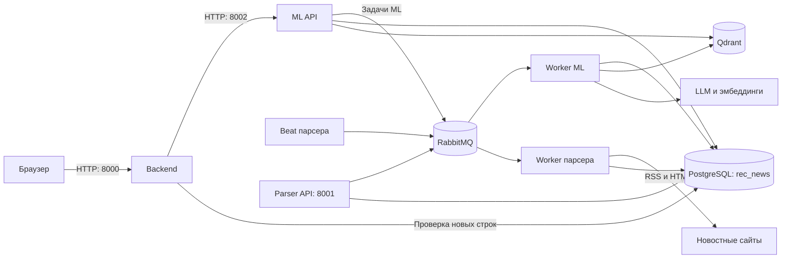
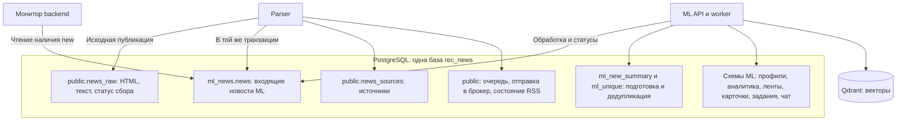
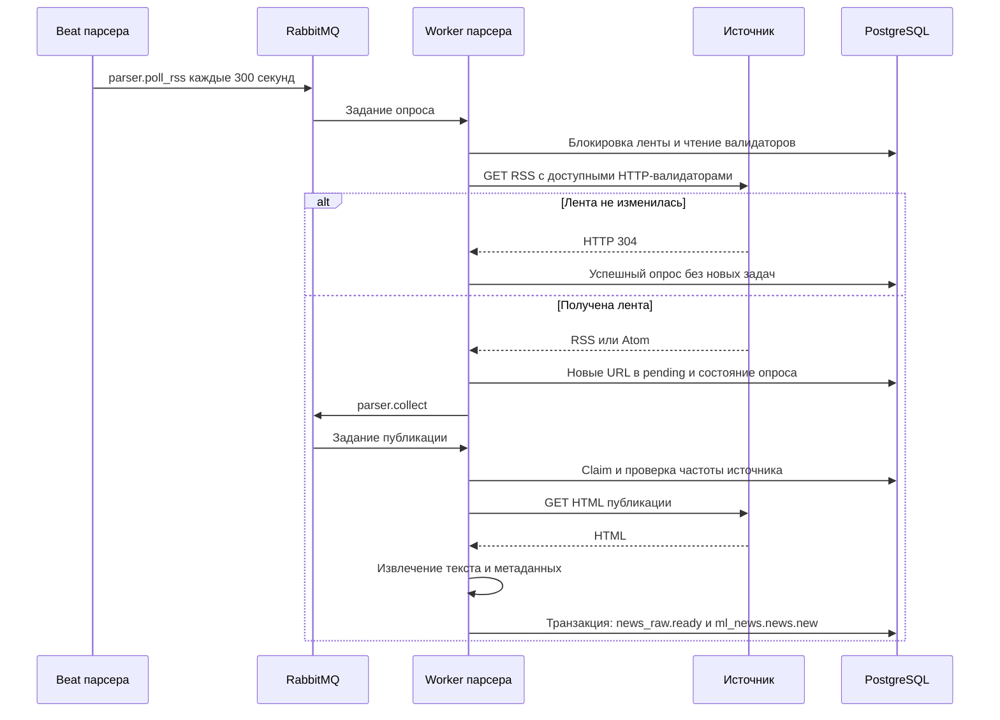
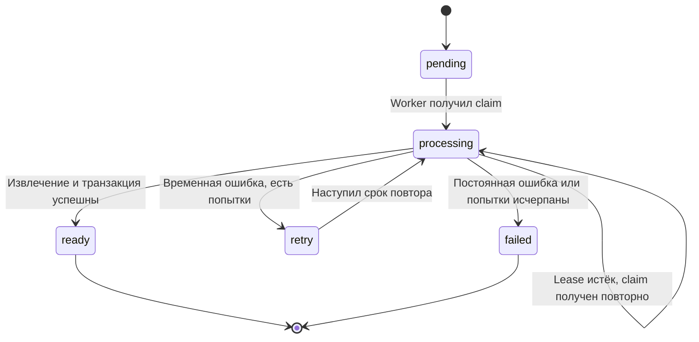
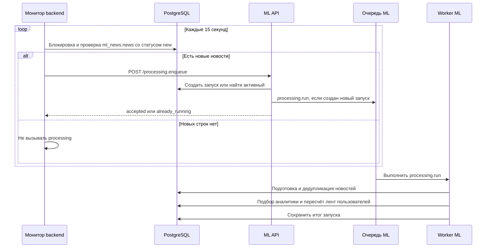
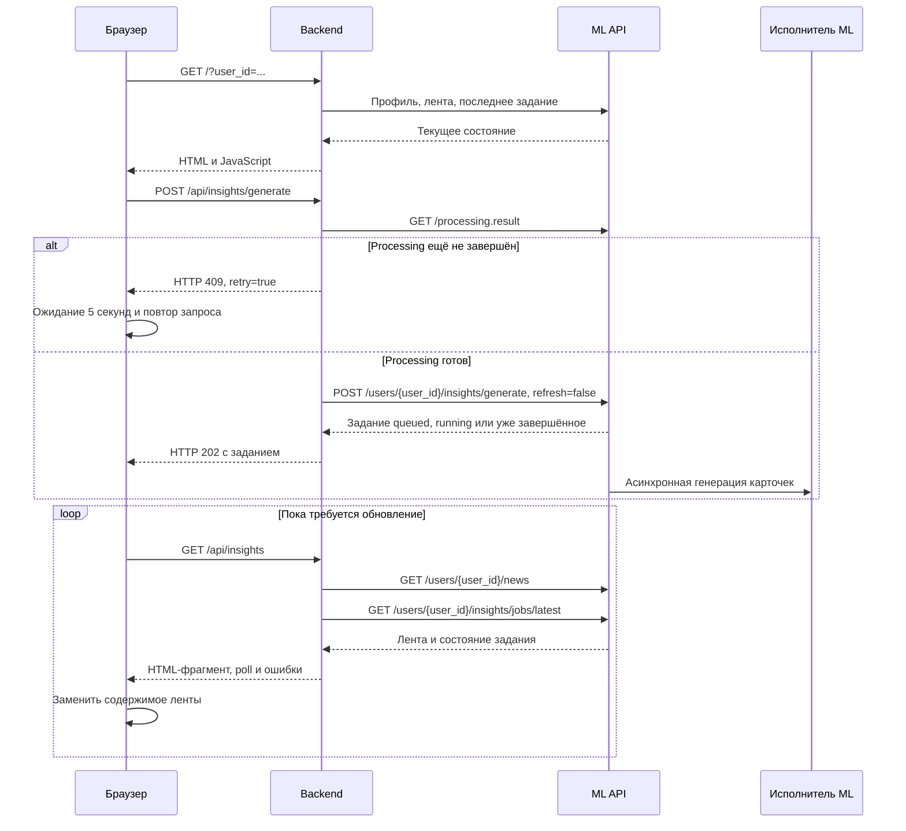
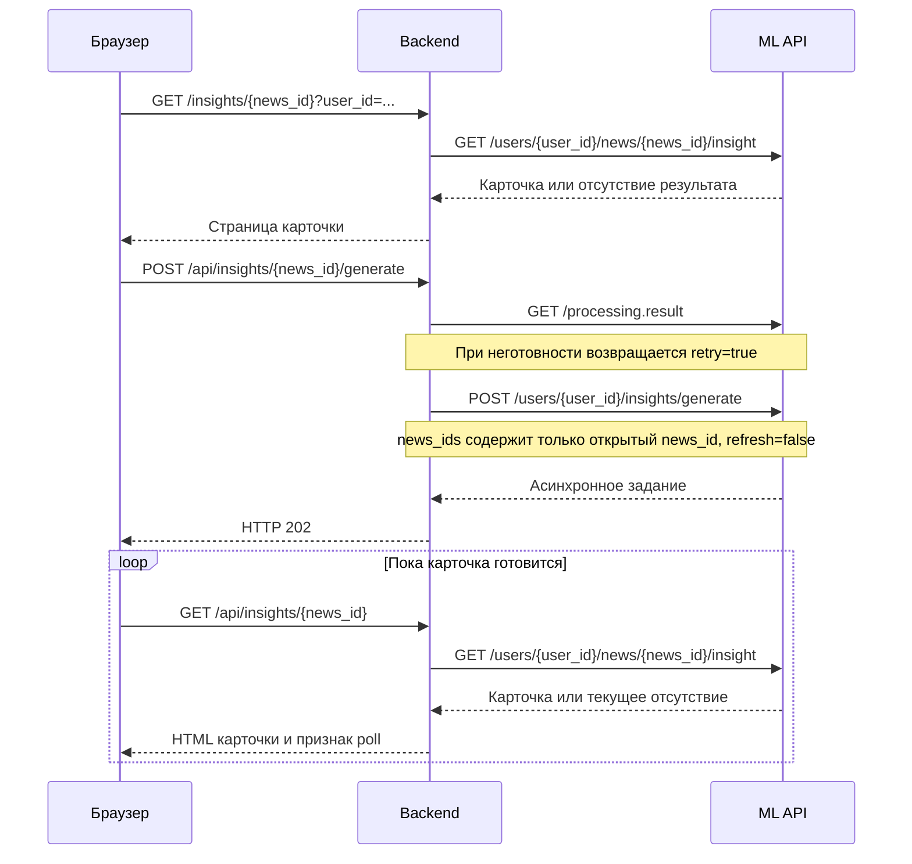
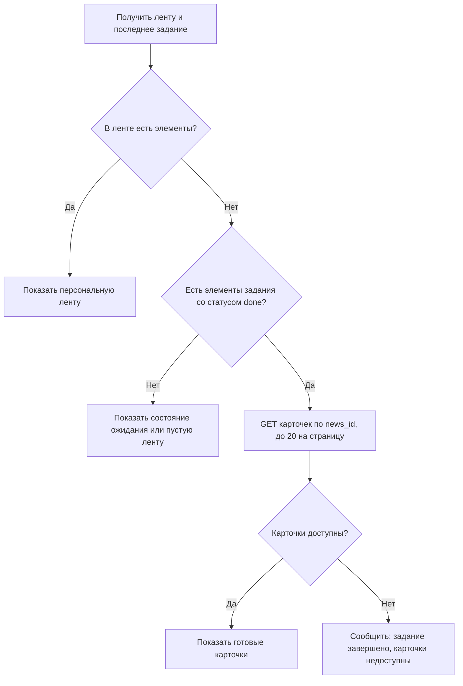
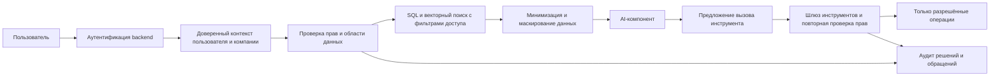
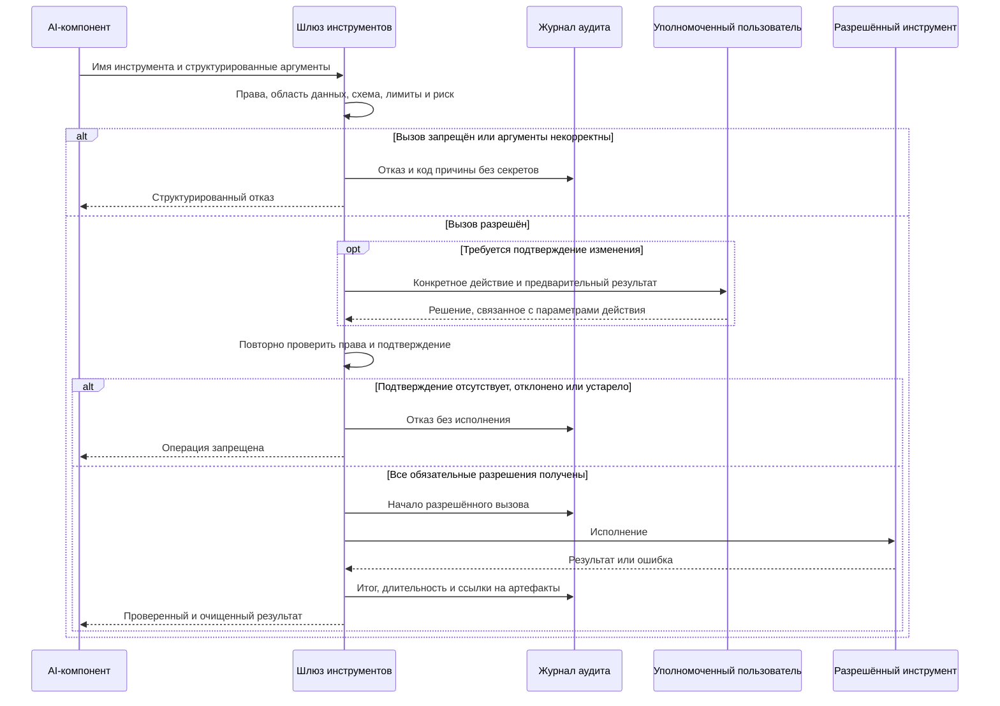

# Архитектура rec_news

Общий обзор реализации на 26.10.2026. Документ описывает взаимодействие сервисов,
хранение и пользовательские сценарии. Команды запуска и полные настройки:
[parser](../services/parser/README.md), [backend](../services/backend/README.md),
[ML](../services/ml/README.md). Контракты:
[входные новости](news-schema.md), [ML API](../services/ml/docs/api.md).

Схемы написаны на Mermaid. Это обзор возможностей текущего кода, а не отчёт
о доступности конкретных запущенных процессов.

## 1. Сервисы и инфраструктура

- **Parser** обнаруживает публикации, загружает HTML, извлекает полный текст
  и передаёт входные новости ML. Классификация и генерация выводов здесь не выполняются.
- **Backend** обслуживает веб-интерфейс и запускает обработку новых новостей
  через ML API. Пользователь выбирает существующий демо-профиль без авторизации;
  `user_id` передаётся в URL. Профили, ленты и карточки предоставляет ML.
- **ML** подготавливает и дедуплицирует новости, подбирает аналитику,
  рассчитывает персональные ленты и генерирует карточки инсайтов.
- **PostgreSQL** — общая реляционная БД со схемами разных владельцев.
- **RabbitMQ** — брокер. Worker парсера и worker ML — отдельные процессы.
- **Qdrant** — векторный индекс ML. LLM и модели эмбеддингов относятся к ML.

Основная конфигурация схем — PostgreSQL, RabbitMQ/Celery и Qdrant-сервер.
Для локальной разработки сохраняются SQLite, локальный worker парсера
и очередь ML внутри процесса API.



Показаны основные связи, а не все внутренние вызовы. При локальной очереди ML
исполнитель находится в API, отдельный Celery worker не нужен. Состояние задач
хранится в БД: пустая очередь RabbitMQ не означает завершение всей обработки.

## 2. Общая БД и владельцы данных



Parser создаёт свои таблицы в `public` по умолчанию. ML создаёт схемы `ml_*`,
включая `ml_news.news`. Backend не создаёт схем и не изменяет статусы новостей.
Интерфейс получает данные через ML API; фоновый монитор напрямую проверяет
в PostgreSQL только наличие входных строк со статусом `new`.

В одной транзакции сохраняются `news_raw.ready` и `ml_news.news.new`.
Если запись в ML не удалась, готовность сырой публикации не фиксируется.
ID входа ML: `parser:{source_code}:{SHA256(canonical_url)}`. Повторная передача
не создаёт дубликат и не сбрасывает уже изменённый статус ML. Происхождение —
в `extra.parser`. Диаграмма показывает логические связи и не задаёт новых
внешних ключей между схемами.

У всех сервисов должны совпадать сервер, порт и имя БД; пользователи могут
отличаться по правам. Смена URL не переносит данные из SQLite автоматически.
Qdrant остаётся отдельным векторным хранилищем.

## 3. Сбор RSS и полного HTML

Рабочие ленты — Интерфакс и пресс-релизы ЦБ. Наличие URL-адаптера для другого
источника не гарантирует сетевую доступность его RSS или HTML.



RSS обнаруживает ссылки; заголовки, анонсы и даты ленты не заменяют данные
полной статьи. Уникальность определяется источником и каноническим URL.
Семантическое объединение разных публикаций относится к ML.

Состояние опроса, блокировка, `ETag` и `Last-Modified` сохраняются в БД.
При остатке необработанных ссылок валидаторы пока не кешируются. Ошибки
увеличивают паузу; учитывается `Retry-After`. Beat каждые 10 секунд запускает
восстановление отправки доступных заданий. Сбой брокера не удаляет сохранённые задания.



Максимум три попытки, обычные паузы — 60 и 120 секунд. Lease — 15 минут;
устаревший worker не перезаписывает новый claim. Между началами запросов
одного источника минимум 5 секунд; при 403/429 пауза минимум 15 минут.
Синхронные `/parse` и `/collect` имеют отдельный процессный ограничитель
частоты. Для постоянного сбора используется очередь.

## 4. Запуск processing из backend

Монитор работает в lifespan backend, независимо от наличия посетителей сайта.
Он читает только наличие строк `new`, не меняет статусы и не запускает
ML-модели сам. Блокировка PostgreSQL защищает одновременную отправку несколькими
backend; ML дополнительно объединяет активные запуски.



Последовательность ML: подготовка → дедупликация/события → подбор аналитики →
пересчёт пользовательских лент. Это отдельный процесс от генерации карточек.
`GET /processing.result` возвращает готовность согласно контракту ML:
есть готовые новости и нет активного processing. Он не гарантирует, что
у каждого профиля лента непустая. Ошибка БД или ML у монитора повторяется
на следующем интервале. Статус монитора: `GET /api/processing/status` backend.

## 5. Вход пользователя и генерация инсайтов

Авторизации в демо нет: `/profiles` позволяет выбрать профиль, `/` без
`user_id` выбирает первый доступный. Выбор профиля не является механизмом
контроля доступа. Backend проверяет соответствие идентификаторов в ответах ML,
но это не заменяет проверку прав пользователя.



Запуск выполняется отдельным POST из JavaScript; чтение страницы или GET
состояния не создаёт задание. Опрос повторяется каждые 5 секунд, максимум
180 раз. `refresh=false` позволяет использовать готовые карточки и текущие
задания без принудительного пересоздания.

## 6. Открытие карточки и пустая лента



Backend использует очередь генерации, а не синхронный POST одиночной карточки.
Если активное задание пользователя пока не охватывает нужную новость, запуск
откладывается и повторяется. Готовая карточка читается отдельным GET.

Лента и последнее задание — разные сущности. Backend дополнительно получает
карточки завершённых элементов задания, когда персональная лента пуста:



`news_id` и `card_id` различаются. Ответ `done` не доказывает доступность
результата; её подтверждает GET карточки. Дополнительное чтение показывает
результаты последнего задания, а не восстанавливает всю историю рекомендаций.

## 7. Обоснование ответа и трассировка карточки

ML собирает `evidence.sources`, выбранную аналитику, использованные данные
компании и `evidence.trace`. Трассировка строится кодом из контекста генерации:
отбор новости, объединение публикаций, подбор аналитики, данные компании,
модели блоков и результаты проверок. Программные проверки и агент-проверщик
могут привести к исправлению, исключению или упрощению блоков.

Backend отображает эти данные и раздел «Как получен вывод», если `trace`
не пуст. Без LLM предусмотрен режим `degraded`. Пустое поле не подменяется
вымышленными этапами. Это объяснение происхождения ответа; оно не является
техническим журналом запросов, аудитом безопасности или внутренним ходом
рассуждений модели.

## 8. Проектные механизмы безопасности AI-компонентов

**Этот раздел описывает гипотетическое развитие системы. Механизмы ниже
не следует считать уже реализованными средствами защиты.** Текущий backend
работает без пользовательской авторизации; `user_id` из URL не доказывает
принадлежность к компании. Есть проверки URL источников, соответствия ID в
ответах ML и проверка содержания карточек. Это не полноценные RBAC, DLP
или аудит вызовов инструментов.

### 8.1. Разграничение прав и границы доверия

Предлагается аутентификация пользователя в backend с получением доверенного
контекста: идентификатор пользователя, компания, роли и разрешённые операции.
Параметр `user_id` запроса проверяется против этого контекста. Межсервисные
вызовы используют отдельные сервисные учётные данные; модель не получает
секреты этих учётных записей и не определяет свои полномочия.

Предлагаемые роли и права:

- Пользователь компании читает только разрешённые ей профили, ленты и карточки.
- Оператор управляет запуском и повтором задач в пределах своей области.
- Администратор управляет настройками и выдачей прав отдельными действиями.
- Parser пишет исходные публикации и вход ML, но не читает приватные профили.
- Монитор backend читает наличие входных новостей и вызывает processing,
  не редактируя аналитические результаты.
- Worker ML читает разрешённый контекст и пишет результаты обработки;
  доступ к внешним действиям по умолчанию отсутствует.

Фильтрация по компании применяется до формирования контекста модели: в SQL,
поиске Qdrant, кэше, истории чата и чтении карточек. Возможные средства —
отдельные роли БД, PostgreSQL RLS и обязательные фильтры метаданных вектора.
Одного фильтра в интерфейсе или инструкции в prompt недостаточно.



Схема проектная. Внешний текст, документ, результат поиска и ответ модели
считаются недоверенными данными. Они не могут менять роль, компанию, политику
доступа, адрес сервиса или разрешённый набор инструментов.

### 8.2. Защита чувствительных данных

Перед передачей в модель предлагается выделять только необходимые поля
и фрагменты. Секреты подключения, API-ключи, пароли, токены и служебные
заголовки не включаются в prompt, ответ или журнал. Персональные и внутренние
данные компании маскируются либо псевдонимизируются; таблица обратного
соответствия хранится отдельно с ограниченным доступом.

Маршрут инференса выбирается по классу данных: внешний LLM получает только
разрешённый очищенный контекст; для ограниченных данных используется
согласованная локальная или изолированная модель либо запрос отклоняется.
Такой выбор не отменяет проверки прав и не делает локальную модель автоматически
безопасной. Для провайдера отдельно задаются правила хранения запросов,
допустимость обучения на данных и сроки удаления.

Дополнительные проектные меры: TLS между сервисами, шифрование хранилищ
и резервных копий, менеджер секретов вместо передачи рабочих ключей модели,
разделение кэша по компании и правам, сроки хранения и удаление производных
данных, включая векторы, историю чата и сохранённые ответы. В логах используется
очищенный минимум; доступность карточки не открывает доступ к её закрытым источникам.

### 8.3. Контроль обращений к инструментам

AI может предложить операцию, но исполняет её отдельный программный шлюз.
Каждый инструмент регистрируется с именем, версией, схемой аргументов,
допустимой областью данных, требуемой ролью и классом риска. По умолчанию
доступ запрещён; в первой версии целесообразны только операции чтения.

До вызова шлюз проверяет типы и размеры аргументов, разрешения пользователя
и сервисной роли, принадлежность объектов компании, лимиты и назначение вызова.
SQL формируется параметризованными запросами, а не исполняется как текст модели.
Сетевые инструменты используют разрешённые адреса, проверку редиректов,
запрет приватных/служебных адресов для внешнего сбора и защиту от подмены DNS.
Для исполнения задаются таймаут, лимит результата, число вызовов, параллелизм
и бюджет токенов. Ответ инструмента также проверяется перед повторной подачей модели.



В проектной реализации отсутствие подтверждения, его истечение или изменение
параметров означает запрет исполнения. Подтверждение модели либо текст
«пользователь разрешил» в новости не считаются разрешением человека.

### 8.4. Журналирование и наблюдаемость

Предлагается передавать `request_id`/`trace_id` через backend, ML, сообщения
очередей и вызовы инструментов, связывая их с ID запуска, задания и карточки.
Аудит должен охватывать разрешённые, отклонённые и неуспешные попытки.
Минимальная запись содержит:

- время, инициатора, компанию/область доступа и сервисную роль;
- инструмент и версию, версию модели и политики;
- очищенные аргументы или их контрольный отпечаток;
- решение проверки прав, необходимость и ID подтверждения;
- начало, завершение, длительность, код результата/ошибки;
- ID входных источников и выходных артефактов, объём/стоимость вызова при наличии.

Полные секреты, необработанные приватные prompts и внутренние рассуждения
модели в аудит не записываются. Если требуется сохранять чувствительные
входы для расследования, это отдельное защищённое хранилище с собственной
политикой доступа и сроками, а не обычный application log.

Журнал предполагает ограничение чтения и записи, защиту от незаметного
изменения, сроки хранения и контроль доступа к выгрузкам. Алерты — на массовые
отказы, попытки доступа к другой компании, всплески вызовов и ошибки инструментов.
Пользовательский `evidence.trace` объясняет ответ и не заменяет этот аудит.
При недоступности обязательного аудита потенциально опасные операции запрещаются.

### 8.5. Ограничение потенциально небезопасных действий

В проектной политике AI не получает универсальный shell, произвольный SQL,
доступ к секретам, управление правами или свободный сетевой доступ.
Платежи, отправка сообщений, публикация от имени компании, удаление данных,
изменение реквизитов и выполнение кода запрещены по умолчанию. Подключение
каждого такого действия требует отдельного инструмента и политики.

Для допустимого изменения предлагаются предварительный просмотр, проверка
схемы, подтверждение уполномоченным человеком, ограниченная область записи,
ключ идемпотентности и защита от повторной доставки. Подтверждение связывается
с конкретными параметрами и сроком действия; до исполнения права проверяются
повторно. Для особо рискованных действий возможно согласование двумя ролями.
Штатная запись результатов ML выполняется кодом конвейера и не предоставляет
модели право произвольно менять таблицы.

Для защиты от prompt injection контент новостей и retrieved-документов
отделяется от системных инструкций. Указания внутри источников не дают прав
на вызов инструментов или раскрытие данных. Проверки источников и результатов
дополняются детерминированными ограничениями шлюза; один prompt или проверяющая
модель не являются достаточной защитой.

Предусматриваются аварийное отключение инструментов, отмена задач, ограничение
цепочек автоматических действий и безопасный отказ при неопределённости.
Гипотеза или рекомендация в карточке не превращается в исполненную операцию
без отдельного разрешённого процесса.

### 8.6. Как проверять эти механизмы перед внедрением

Проектный набор проверок: доступ к чужим профилям и векторам, утечки секретов
через ответ/логи/кэш, инструкции злоумышленника внутри новости, подмена параметров
после подтверждения, повторная доставка изменяющей операции, SSRF/редиректы,
превышение бюджета, недоступность аудита и отключение инструмента во время задачи.
Успех означает проверяемый отказ либо ограниченное разрешённое действие,
а не только корректную формулировку ответа модели.

## 9. Развёртывание и конфигурация

Основной описанный запуск — Python-процессы через `uv`, инфраструктура может
работать в Docker. Наличие Dockerfile API не запускает worker или Beat
автоматически. Worker ML и parser настраиваются отдельно.

Адреса прослушивания в `.env` сервисов:

```dotenv
# services/backend/.env
BACKEND_API_HOST=0.0.0.0
BACKEND_API_PORT=8000

# services/parser/.env
PARSER_API_HOST=0.0.0.0
PARSER_API_PORT=8001

# services/ml/.env — переменные поддерживаются скриптом ML
REC_NEWS_API_HOST=0.0.0.0
REC_NEWS_API_PORT=8002
```

`0.0.0.0` — все IPv4-интерфейсы. В браузере и URL подключения используется
`127.0.0.1` либо реальный IP/имя сервиса. Backend подключается к ML через
`ML_API_URL`. В контейнерной сети вместо localhost соседнего контейнера
используется его DNS-имя. Изменение порта API требует согласования клиентов
и проброса портов Docker. Демо без авторизации рассчитано на доверенную среду;
публичный доступ не является следствием наличия только host-настройки.

Общая БД задаётся `PARSER_DATABASE_URL`, `REC_NEWS_DATABASE_URL` у ML
и `BACKEND_DATABASE_URL` у backend. Префикс схем ML по умолчанию — `ml_`.
Схема входа должна совпадать с `PARSER_ML_NEWS_SCHEMA` и
`BACKEND_ML_NEWS_SCHEMA`. Пароли и реальные секреты в архитектурный документ
не включаются. Для parser/backend файл окружения явно загружается командой
`uv run --env-file .env ...`; ML также читает свой `.env` штатным модулем.

Порядок подготовки:

1. PostgreSQL с созданной БД, RabbitMQ и Qdrant-сервер.
2. Инициализация схем ML; затем инициализация parser, проверяющая входную таблицу ML.
3. ML API и исполнитель его задач, затем parser API/worker/Beat.
4. Backend с включённым монитором; для реальных новостей — согласованные
   настройки времени и подготовленные профили/аналитика ML.

Подробные команды остаются в README сервисов; этот документ не требует
заменять ими существующие рабочие `.env`.

## 10. Диагностика и границы текущей реализации

- `POST /parse` parser проверяет извлечение без сохранения; `POST /collect` —
  синхронную запись; `POST /queue` — постановку в рабочую очередь.
- `GET /queue/{job_id}` и `GET /rss/status` parser показывают сбор.
- `GET /api/processing/status` backend показывает работу монитора.
- `GET /processing.result` ML показывает готовность processing по его контракту.
- `GET /users/{user_id}/news` ML показывает ленту, а
  `GET /users/{user_id}/insights/jobs/latest` — последнее задание генерации.
- `GET /users/{user_id}/news/{news_id}/insight` ML подтверждает доступность карточки.

На уровне кода реализованы сбор и общая запись в PostgreSQL, оркестрация
processing через backend, генерация и чтение карточек, пользовательская
трассировка происхождения. Сквозное поведение зависит от согласованной
конфигурации всех процессов и подготовленных данных ML.

Отдельные ограничения: демо без авторизации; не все источники доступны
обычным HTTP-запросом; архивные SQLite-данные сами не мигрируют; завершённое
задание не доказывает наличие текущей ленты. Проектные средства AI-безопасности
из раздела 8 ещё требуют реализации и проверки.

Исторические документы, например `shared-database.md`, могут отражать ранний
этап с отдельными SQLite-базами. Для текущих границ сервисов используйте
этот обзор, актуальные README и контракт `news-schema.md`.

## 11. Метрики качества

### 11.1. Качество персонального отбора и ранжирования

Предоставленные результаты оценки ML:

- **nDCG@10 = 0.651** — качество порядка первых десяти элементов с учётом
  степени релевантности и большего веса верхних позиций, относительно идеального порядка.
- **Precision@10 = 0.54** — доля релевантных элементов в первых десяти: 54% в среднем
  при принятом в эксперименте определении релевантности.
- **MRR = 0.86** — среднее обратное место первого релевантного элемента.
  В отличие от двух предыдущих метрик, ограничение `@10` для этого результата не задано.

Эти значения характеризуют подбор и ранжирование новостей/событий, на основе
которых пользователь видит инсайты. Они не являются оценкой фактической
точности, полноты или безопасности сгенерированного текста карточки.
Значения переданы участником проекта и здесь не пересчитывались. Набор,
объём выборки и протокол эксперимента для этих чисел пока не зафиксированы
в данном документе; сравнивать их с другими запусками следует после их уточнения.

Для воспроизводимого отчёта рядом с метриками нужно сохранять идентификатор
и версию набора, количество профилей/запросов, правила разметки релевантности,
способ усреднения, окно новостей и демо-время, версии кода, моделей и конфигурации.
Метод оценки должен определять поведение для коротких лент и запросов без
релевантных элементов. Пустые и проблемные случаи не исключаются молча.
Скрипты оценки ML находятся в `services/ml/scripts_for_tests/`; конкретный
скрипт и параметры, породившие эти результаты, нужно указать в отчёте запуска.

### 11.2. Качество текста карточки — отдельный контур

Для дальнейшей оценки предлагаются отдельные показатели: доля утверждений,
подтверждённых источниками, корректность чисел и ссылок, полнота обязательных
блоков, соответствие профилю компании, доля `ready`/`partial`/`degraded`,
ошибки генерации и время получения готовой карточки. Проверка безопасности
AI-инструментов из раздела 8 также проводится отдельно от ранжирования.
Численные результаты для этих показателей пока не приведены.
